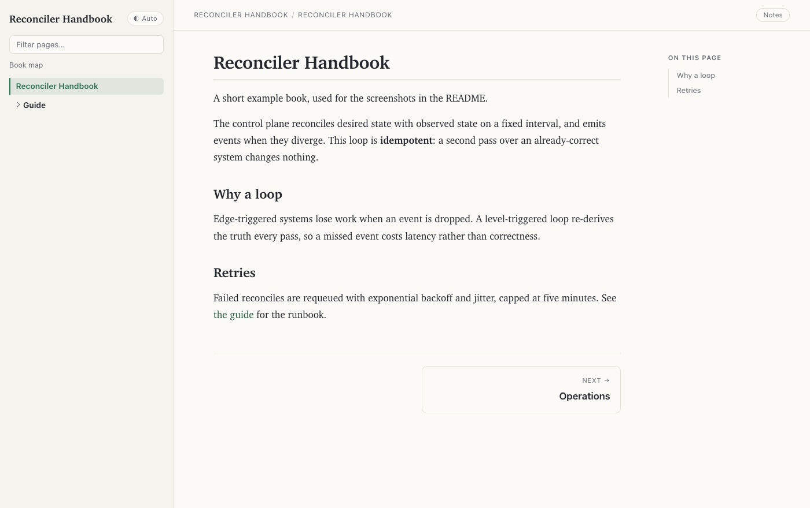
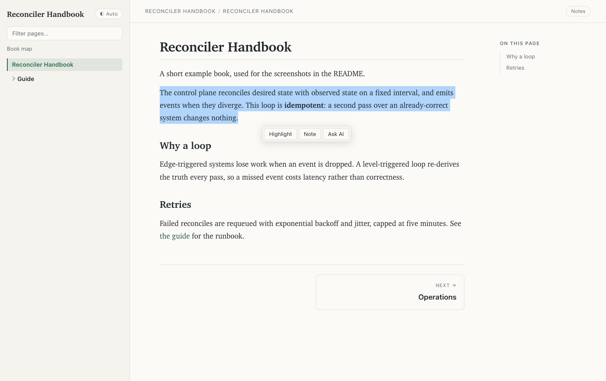
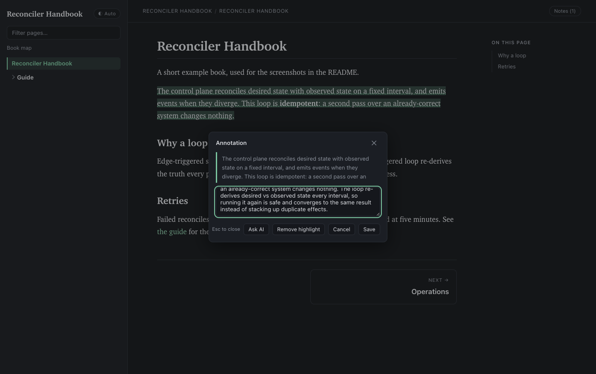
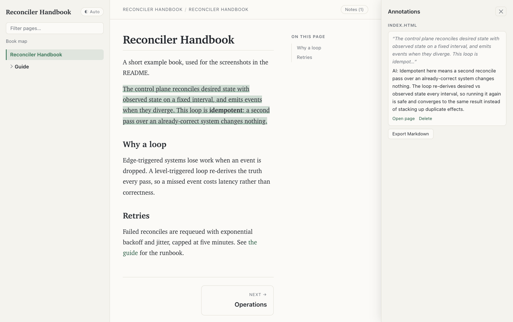
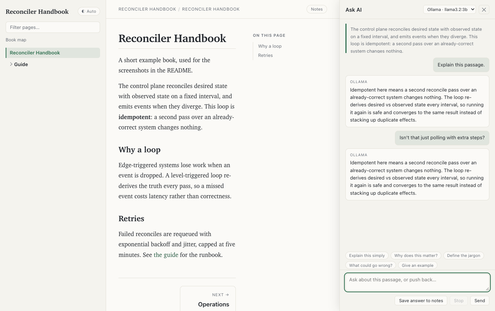
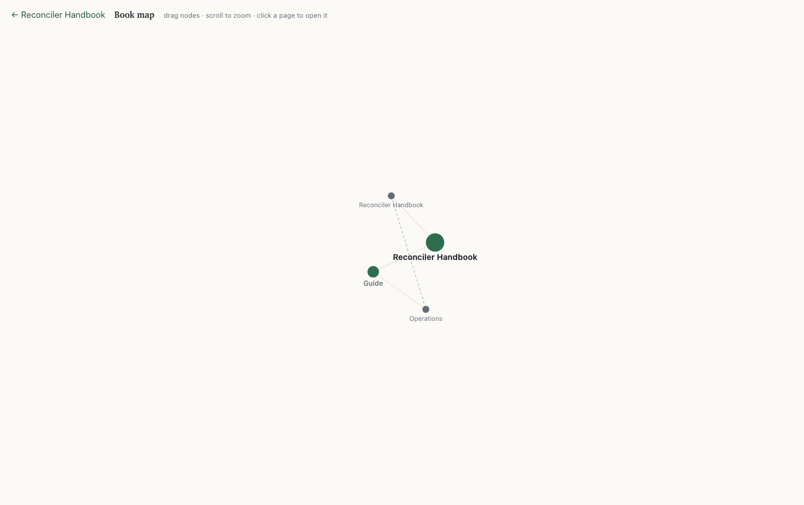

# bookify

Point it at a folder of docs and get a browsable book — in HTML **and** Markdown.
No config file, no scaffolding, no site generator to learn.

```bash
bookify ./docs
```

That builds the book, opens it in your browser, and stops the server when you
close the last tab.



It handles mixed folders: Markdown and MDX, reStructuredText, plain HTML pages,
`.txt`/`.adoc`, and optionally source code — so it reads the sources of
Docusaurus, MkDocs, Sphinx, Hugo, Jekyll, VitePress and friends as they are (see
[Docs systems](#docs-systems)). Cross-links between formats are rewritten so
`.md ↔ .html` links keep working, and images the pages reference are copied
along with them.

---

## Install

Needs [uv](https://docs.astral.sh/uv/) — dependencies are declared inline
(PEP 723), so there's no venv to create.

```bash
curl -LsSf https://astral.sh/uv/install.sh | sh   # if you don't have uv
install -m 755 bookify ~/.local/bin/bookify       # anywhere on your PATH
```

On a network that intercepts TLS, uv needs the system trust store for its first
dependency fetch: `export UV_NATIVE_TLS=1`.

### Windows

Windows can't run a shebang script directly, so a one-line `.cmd` launcher hands
it to uv. In PowerShell, from the repository:

```powershell
winget install --id=astral-sh.uv -e                 # or: scoop install uv
$bin = "$HOME\.local\bin"; New-Item -ItemType Directory -Force $bin | Out-Null
Copy-Item bookify $bin
Set-Content "$bin\bookify.cmd" '@uv run --script --quiet "%~dp0bookify" %*'
[Environment]::SetEnvironmentVariable('Path', "$bin;" + [Environment]::GetEnvironmentVariable('Path', 'User'), 'User')
```

Open a new terminal and `bookify` works in PowerShell and cmd. Git Bash runs the
extensionless script from the same folder by itself, and WSL follows the Linux
steps above.

## Usage

```bash
bookify                               # render the current directory and serve it
bookify <folder>                      # build to ~/.cache/bookify/<name>-<hash>/ and serve
bookify <folder> --no-serve           # build only — use this from scripts and agents
bookify <folder> --serve 9000         # serve on a specific port
bookify <folder> --keep-alive         # don't auto-stop when browser tabs close
bookify <folder> -o /path/out         # custom output dir
bookify <folder> --format html        # html | md | both (default: both)
bookify <folder> --title "My Docs"    # book title (default: folder name)
bookify <folder> --include-code       # render source files as highlighted pages too
bookify <folder> --ai [MODEL]         # add an AI overview page via local Ollama
bookify <folder> --ask-provider ID    # force the Ask AI backend
bookify <folder> --no-ask             # turn the Ask AI sidebar off
```

Output lives outside the folder you scanned (`~/.cache/bookify/` by default), so
rendered artifacts never pollute a repo. Every output directory also gets a
`.gitignore` containing `*` as a safety net for custom `-o` paths.

## Docs systems

Point bookify at the folder holding the sources, not the generator's build
output (which it skips anyway: `_build/`, `_site/`, `build/`, `dist/`).

| Docs system | Sources usually live in | Command |
|---|---|---|
| Docusaurus | `docs/` (and `blog/`) | `bookify docs` |
| MkDocs, Material for MkDocs | `docs/` (`docs_dir` in `mkdocs.yml`) | `bookify docs` |
| Sphinx | `docs/` or `docs/source/` | `bookify docs` |
| VitePress | `docs/` | `bookify docs` |
| Astro Starlight | `src/content/docs/` | `bookify src/content/docs` |
| Nextra | `pages/` or `content/` | `bookify pages` |
| Hugo | `content/` | `bookify content` |
| Jekyll, GitHub Pages | repo root or `docs/` | `bookify docs` |
| mdBook | `src/` | `bookify src` |
| GitBook, plain Markdown repo | repo root | `bookify .` |
| GitHub wiki | the `.wiki` repository | `git clone https://github.com/OWNER/REPO.wiki.git && bookify REPO.wiki` |
| Obsidian vault, notes folder | the vault | `bookify ~/notes` |
| Code with its docs | repo root | `bookify . --include-code` |

Every other flag combines as usual, for example
`bookify docs --title "Acme Docs" --no-serve -o ./book`.

### Navigation

The sidebar, the reading order and Previous/Next follow the docs system's own
navigation, and the startup banner says where it came from:

```
Navigation:    mkdocs.yml nav (83 of 96 pages listed)
```

| Docs system | Navigation read from |
|---|---|
| MkDocs | `nav` in `mkdocs.yml`, beside or above the docs folder |
| mdBook, GitBook | `SUMMARY.md`, part titles included; draft chapters are skipped |
| Sphinx | the toctree hierarchy from `root_doc` in `conf.py`, reStructuredText or MyST |
| Docusaurus | `sidebars.ts`/`.js`/`.json`: categories, doc ids, `autogenerated` folders |
| VitePress | `themeConfig.sidebar`, with `base` prefixes, `rewrites` and helper functions |
| Starlight | `sidebar` in `astro.config`: slugs, links and `autogenerate` |
| Jekyll | `_data/docs_nav.yml` (or `navigation.yml`, `nav.yml`, …), matched by permalink |
| Anything else | folders, ordered by `_category_.json`/`.yml` (Docusaurus), `_index.md` weights (Hugo), number prefixes (`02-guides`) and front matter; names sort naturally, `page2` before `page10` |

Pages the navigation doesn't list still appear, after the ones it does.
Configuration is read, never run: JavaScript sidebars are parsed as literals.
Translations in VitePress and Starlight `locales` folders are left out.

### Content

- **Front matter** (YAML `---` or TOML `+++`) is stripped, and `title` names the page.
- **Callouts**: `:::tip Title` (Docusaurus, VitePress, Starlight), `> [!NOTE]`
  (GitHub), foldable `> [!tip]- Title` (Obsidian), `!!! note` and `??? note`
  (MkDocs), and `.. note::` (reStructuredText).
- **Material for MkDocs**: content tabs (`=== "Tab"`), snippets (`--8<--`), and
  code blocks inside admonitions, tabs and list items.
- **GitHub-flavoured Markdown**: task lists, strikethrough, bare links, and
  `<details>` blocks with Markdown inside.
- **Code blocks** keep their language. A `title="…"` in the info string becomes
  a caption; line ranges and flags such as `{1,3}` or `showLineNumbers` are ignored.
- **Obsidian**: `[[wikilinks]]` with aliases, headings and paths resolve the way
  Obsidian resolves them, `![[image.png|300]]` embeds an image, `![[Note#Section]]`
  on its own line shows that section, and links to missing notes are marked.
- **Hugo shortcodes**: callouts (`hint`, `notice`, `alert`, …), `details`, tabs,
  `highlight` and `code-toggle`, `figure`/`img`, `include`, `ref`/`relref`,
  `param`, `youtube`, and `new-in` badges. Escaped examples (``)
  stay literal; shortcodes only the site's own templates can render are removed.
- **Jekyll Liquid and mkdocs-macros**: variables (`page.*`, `site.*`, `config.*`,
  `extra`), `relative_url`, `link`, `post_url`, `include`, `highlight`, `raw`
  and `comment`. Loops and conditions keep their contents but aren't evaluated.
- **MDX**: `import`/`export` lines and `{/* comments */}` are dropped; `Tabs`,
  `Aside`/`Admonition`, `Card`, `LinkCard` and `Badge` render; live demos are left out.
- **reStructuredText** renders through docutils; Sphinx-only directives are
  omitted quietly.
- **Links** without an extension (`./setup`) and site URLs (`/docs/setup/`,
  permalinks, slugs) resolve to the page.

What doesn't carry over is anything that needs the generator itself to run:
loops over site data, a site's custom shortcodes and components, and pages
generated from data files.

## Reading features

### Highlights and notes

Select any text to highlight it or attach a note.



Click a highlight to edit or remove it; re-select over one and the toolbar
offers **Unhighlight** directly. The editor closes via the ✕, the backdrop,
`Esc` or *Cancel* — none of which change the annotation.





### Where your state lives

Notes are kept in **two places at once**, and either one can rebuild the other:

| Store | Scope | Survives |
|---|---|---|
| **IndexedDB** (`bookify` database) | the browser origin, partitioned by book id | the output directory being deleted, `~/.cache` being cleared, rebuilds |
| **`annotations.json`** next to the book | that book's output directory | browser data being cleared, a different port, a different browser, opening the book off disk |

The reason for both: IndexedDB is scoped to an *origin including the port*, so a
book served on `--serve 9000` is a different database from the same book on
8123 — and some browsers give `file://` pages no IndexedDB at all. The JSON file
is port-independent, so it carries your notes across. On every page load the two
are merged, and the merged result is written back to both.

Each book gets a stable id derived from its source path, so it keeps its own
rows even when several books share one origin (which is what happens when you
render different folders on the default port). Renaming with `--title`, moving
the output, or rebuilding does not change it.

Deletes are recorded as tombstones rather than simply dropped — a missing record
is indistinguishable from one the other store has not seen yet, so without them
a deleted note could come back on the next merge. They are pruned after 30 days.

Ask AI conversations are stored too, one thread per passage, so reopening a
highlight brings the discussion back rather than starting over.

If IndexedDB is unavailable (private windows, site data blocked), bookify falls
back to `localStorage`, and to the server file alone if that is blocked as well.

Annotations survive rebuilds and export to Markdown from the Notes panel.

### Ask AI

Select a passage and hit **Ask AI** to open a chat sidebar about it. It opens
with an explanation and then takes follow-ups, so you can question the answer or
argue with it.



- The passage plus ~700 characters either side go along as context, so answers
  stay grounded in the page rather than in the model's general knowledge.
- **Save answer to notes** attaches the reply to that highlight.
- **Stop** cancels a reply mid-stream and keeps the partial text; `Esc` or ✕
  closes the panel.

**It uses whatever is already on your machine** — nothing to configure. bookify
probes for, in order:

| Backend | How it's used |
|---|---|
| **Ollama** | `/api/chat`, streaming token by token. Free and local. |
| **Claude Code** (`claude`) | `claude -p`, streamed |
| **Codex** (`codex`) | `codex exec`, final message |
| **Gemini** (`gemini`) | `gemini -p`, streamed |

The startup banner tells you what it found and what it picked:

```
Ask AI:        Ollama (llama3.2:3b), Claude Code (CLI)  — using Ollama
```

A dropdown in the panel switches backend per question. If nothing is installed
the button simply doesn't appear — likewise when the book is opened straight off
disk over `file://`, which has no server to proxy through.

Point `BOOKIFY_OLLAMA` elsewhere (default `http://127.0.0.1:11434`) to use
Ollama on another port or machine.

> **Note:** the CLI backends spend whatever quota that CLI is on. `--no-ask`
> disables the feature; `--ask-provider ollama` keeps everything local.

### Diagrams and embedded artifacts

A fenced `mermaid` block is drawn as a diagram in the HTML book. The renderer is
a pinned Mermaid build bundled in `assets/vendor/mermaid/` (MIT licence and
provenance beside it), copied into the book only when a page has a diagram, so
diagrams work offline and over `file://`. If a diagram cannot be drawn, the page
shows its source instead.

A fenced `artifact` block embeds a self-contained HTML file:

````md
```artifact
src: ../artifacts/task-graph.html
title: Task dependency graph
height: 640
```
````

`src` (a relative path to an `.html` file) and `title` are required; `height` is
an integer from 200 to 1200 (default 600). A malformed block (unknown key, bad
height, missing, remote or outside `src`) fails the build: stderr names the page and
the problem, the page shows the block's source in an error box instead of a frame,
and bookify exits with status 1 without serving. The rest of the book is still
written. The block becomes an iframe with `sandbox="allow-scripts"`
and nothing else, so the artifact has an opaque origin: it cannot reach the book
page, its notes, its storage or the Ask AI token. The local server sends the same
sandbox as a header when the artifact is opened on its own. The artifact and the
files it references by relative path are copied into the output, unchanged and not
rendered as a page; it is searchable by its title and is a node in the book map.
`--format md` keeps both kinds of block as written.

### Search

`Ctrl K` (`⌘K` on a Mac), or the Search button, searches the text of every page.
Results are ranked, show where the words appear, and open at the matching
section, with the words highlighted on the page until `Esc`. The index is
`search.js` beside the book, so search also works when the book is opened
straight off disk.

### Book map

An interactive force-directed map of the folder structure plus the cross-links
between pages. Drag nodes, scroll to zoom, click a page to open it.



### Everything else

Theme toggle (auto/light/dark), on-page outline with scroll-spy, a sidebar
filter that hides folders it empties, copy buttons on code blocks, and keyboard
navigation — arrows page through the book, `/` focuses the filter.

## Output layout

```
<out>/
  html/          static site — open index.html
  markdown/      SUMMARY.md (contents), one page per file, BOOK.md (all in one)
  annotations.json   your notes — preserved across rebuilds, mirrored to IndexedDB
```

`BOOK.md` is the whole book in a single file, which makes it a convenient blob
of context to hand to an LLM.

Beside the pages, `html/` holds `search.js` (the search index) and, for books
over 400 pages, `nav.js`: the sidebar ships once instead of inside every page,
which keeps a thousand-page book from growing with the square of its size. Set
`BOOKIFY_INLINE_NAV_LIMIT` to move that threshold.

## Security notes

The server binds to `127.0.0.1` only. Because Ask AI shells out to local
assistant CLIs, every request must carry a random per-run token that is handed
out only to the book's own pages — so nothing else in your browser can invoke a
CLI on your machine.

## Tests

```bash
./tests/test_bookify.py                                        # build + server suite
uv run --script tests/test_bookify.py                          # the same, on Windows
uv run --with playwright tests/test_bookify.py --browser       # plus the UI suite
```

The default suite is stdlib-only and takes a few seconds. `--browser` drives a
real browser through the annotation and Ask AI flows; it reuses any chromium
already in your Playwright cache, or tells you to run `playwright install
chromium`. Every check corresponds to a bug that was actually found and fixed.

## License

MIT — see [LICENSE](LICENSE).
